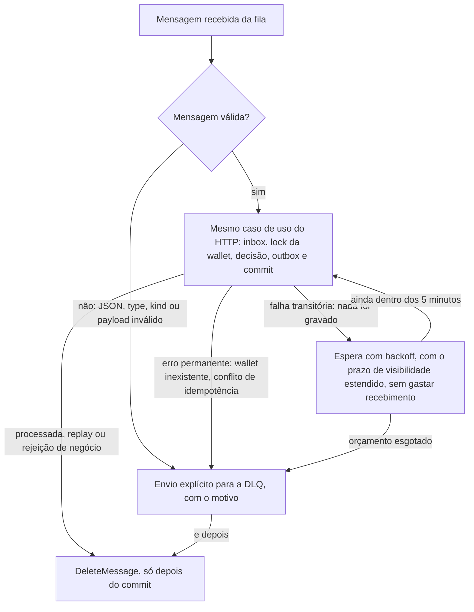

# Fila de entrada e outbox

Como uma operação que chega pela fila `wager-transactions.fifo` vira transação sem duplicar nem se perder, e como os eventos saem depois do commit pela outbox. O resumo das decisões está no [ARCHITECTURE.md](../ARCHITECTURE.md#fila-de-entrada).

## A vida de uma mensagem

Fora desse caminho, há três situações que devolvem a mensagem para a fila, cada uma explicada abaixo: o `SIGTERM` (devolve as que não começaram e as que esperavam nova tentativa), o processo morrer (a mensagem volta quando o prazo vence) e uma chamada que nunca termina (o teto de 6 minutos por mensagem). Em todas, a inbox e a `idempotency_key` impedem que a nova entrega duplique o efeito.

## As filas e o contrato

Filas `wager-transactions.fifo` e `wager-transactions-dlq.fifo`, criadas por [create-queues.ts](../src/infrastructure/messaging/create-queues.ts): FIFO, deduplicação por conteúdo desligada, visibilidade de 30 s, long polling de 20 s, `maxReceiveCount = 10` e retenção de 14 dias na DLQ.

**Contrato da fila:** `MessageGroupId = walletId` e `MessageDeduplicationId = messageId`, com o atributo de mensagem `correlationId` opcional. Quem define esses atributos é o produtor; o desafio não tem produtor, então esse é o contrato documentado, e os testes o seguem. O corpo segue o formato da seção 10 do desafio. O grupo por wallet dá ordem por wallet e paralelismo entre wallets, mas é otimização: a ordem não vale entre HTTP e fila, a janela de deduplicação é de 5 minutos e redelivery acontece. A correção vem do lock da wallet, da inbox e da `idempotency_key`.

## O consumidor

O consumidor ([sqs-consumer.ts](../src/infrastructure/messaging/sqs-consumer.ts)) usa o mesmo caso de uso do HTTP e grava a inbox `(consumer_name, message_id)` no mesmo commit do efeito; `DeleteMessage` só depois do commit. A única diferença para o HTTP é quanto ele espera o lock da wallet: 10 s em vez de 2 s ([timeouts](banco-de-dados.md#concorrência)). A classificação:

| Resultado | Ação |
|---|---|
| sucesso, replay, mensagem já na inbox com o mesmo hash, rejeição de negócio | `DeleteMessage` depois do commit |
| transitório ou inesperado (nada foi gravado) | a mensagem fica com o consumidor, com o prazo de visibilidade estendido, e tenta de novo ali mesmo depois do backoff comum (base 2 s, teto 60 s); esgotado o orçamento de 5 minutos, envio explícito para a DLQ com `reason = RETRY_BUDGET_EXHAUSTED` |
| permanente: JSON inválido, `type` desconhecido, `kind` `OPENING`, payload inválido, `WALLET_NOT_FOUND`, conflito de idempotência, mesmo `messageId` com outro hash | envio explícito para a DLQ (com o atributo `reason`) e depois `DeleteMessage` |

Mensagem inválida é permanente, não negócio, porque sem um comando válido não existe transação para marcar `REJECTED`; o envio explícito evita atrasar as seguintes da mesma wallet. Esse envio não é atômico com o delete: se o processo morrer entre os dois, a mensagem é reclassificada e reenviada, e a deduplicação da DLQ FIFO (mesmo `MessageDeduplicationId`) segura a cópia.

## O limite de tentativas é um orçamento de tempo

**O limite de tentativas é um orçamento de tempo do consumidor, não o `ApproximateReceiveCount`.** O SQS conta um recebimento a cada entrega, inclusive quando a mensagem só volta para a fila por um motivo que não tem nada a ver com ela, então essa contagem não serve de orçamento para uma falha transitória ([o que aconteceu quando ela era o orçamento](medicoes-e-historico.md#quando-o-approximatereceivecount-era-o-orçamento)). A regra é que um recebimento só é gasto quando a mensagem sai das mãos do consumidor: no desligamento (a devolução que o enunciado pede no `SIGTERM`), quando o processo morre, ou quando o SQS não aceita a extensão do prazo. Em todos esses casos a mensagem precisa ser entregue de novo, e cada entrega nova conta. Por isso o `maxReceiveCount` é 10, e não um número pequeno: ele é a rede de segurança para esses casos, e continua tirando da fila uma mensagem que derruba o processo toda vez.

O orçamento é de **5 minutos contados da primeira falha** (`CONSUMER_RETRY_BUDGET_MS`), e não uma contagem, porque com o full jitter uma contagem não garante duração mínima: por sorteio, dez tentativas podem caber em poucos segundos. Com um prazo, a última espera é cortada para terminar junto com o orçamento e a tentativa final acontece no fim dele, então uma queda do banco mais curta que 5 minutos não manda nenhuma mensagem para a DLQ, desde que a instância não morra no meio. Cada nova tentativa conta em `wagering_retries_total{component="sqs_consumer"}` e sai no log `sqs_message_retry_scheduled`, com o `messageId`, o número da tentativa, a espera e o erro, sem valores nem `playerId`; o envio para a DLQ conta em `wagering_dlq_forwarded_total{reason}` e sai em `sqs_message_sent_to_dlq`. O custo é que o orçamento fica em memória, então uma instância que morre com a mensagem em mãos faz a conta recomeçar na próxima.

## Banco fora ou saturado pausa o recebimento

Quando a tentativa falha por conexão com o banco ou por saturação (sem conexão, conexão caída, servidor desligando, `too many clients`, espera por conexão do pool estourada: `isDatabaseUnavailableError`, em [infrastructure-errors.ts](../src/application/infrastructure-errors.ts)), o consumidor para de buscar mensagens novas e só volta quando responde a mesma checagem do banco que a readiness faz (`database.schemaStatus()`, conferida a cada 2 s). A pausa conta em `wagering_consumer_pauses_total{reason="database_unavailable"}`, com os logs `consumer_paused` (que leva o `messageId` da mensagem que falhou) e `consumer_resumed` (com quanto tempo durou). As mensagens que chegam durante a queda ficam na fila sem nenhum recebimento, e as que já estavam em mãos seguem tentando dentro do orçamento delas. Como a busca não espera os grupos em mãos (abaixo), uma busca que já estava aberta quando a pausa começou ainda pode trazer mensagens: elas ficam em mãos e seguem como as outras, sem gastar recebimento.

## A busca não espera os grupos em mãos

A busca não espera os grupos em mãos terminarem, para uma wallet que está tentando de novo por até 5 minutos não segurar as mensagens das outras wallets daquela instância ([o desenho anterior](medicoes-e-historico.md#os-desenhos-anteriores-da-busca-e-da-extensão-de-prazo)). Cada grupo começa assim que chega e a próxima busca sai logo em seguida, enquanto houver vaga no limite de mensagens em mãos de cada instância (`CONSUMER_MAX_IN_FLIGHT_MESSAGES`, 10 por padrão, o mesmo que cabe num recebimento); cada mensagem que é confirmada, vai para a DLQ ou é devolvida abre uma vaga, e cada busca pede só o que cabe. A ordem por wallet continua, porque o FIFO não entrega outra mensagem de um grupo que tem mensagem em mãos, e um teste confere isso no MiniStack. Com grupos em mãos, a busca espera no máximo 1 s em vez dos 20 s do long polling, pelo motivo explicado no [SIGTERM](#sigterm), o que custa até uma chamada `ReceiveMessage` por segundo por instância enquanto ela tem mensagens em mãos.

## Mensagens da mesma wallet e o prazo de visibilidade

Mensagens da mesma wallet no mesmo lote são processadas em ordem, e grupos diferentes vão em paralelo. O grupo inteiro fica com o consumidor até a última terminar, inclusive quando a da frente falha: as seguintes esperam com o prazo estendido, em vez de voltarem para a fila, e seguem quando a da frente termina ou vai para a DLQ. O prazo de visibilidade do grupo ([group-visibility.ts](../src/infrastructure/messaging/group-visibility.ts)) é estendido com `ChangeMessageVisibility` para o prazo cheio da fila, o que não faz o SQS entregar a mensagem de novo e por isso não gasta recebimento, em dois momentos:

- antes de cada mensagem, se não cabe mais uma espera inteira no que sobrou (o `statement_timeout` da fila, 15 s, nos 30 s de visibilidade), para a mensagem não começar com o prazo quase no fim. Estender, e não devolver, é de propósito: cada devolução gastaria um recebimento de uma mensagem que nada tem de errado ([o desenho anterior](medicoes-e-historico.md#os-desenhos-anteriores-da-busca-e-da-extensão-de-prazo));
- durante o processamento e as esperas entre tentativas, sempre que sobra menos de um terço do prazo, porque os 15 s são só uma estimativa: não incluem a espera por conexão do pool, os vários comandos da transação nem o `DeleteMessage`.

Se a extensão antes de uma mensagem falha, as que faltam são devolvidas com visibilidade 0: sem extensão elas voltariam para a fila de qualquer jeito quando o prazo vencesse, e devolver só adianta. Se o `DeleteMessage` falha depois do commit, só ele é repetido, ali mesmo, sem reprocessar e sem nunca ir para a DLQ; se a fila não responder dentro do orçamento, a mensagem volta pela visibilidade e a inbox a reconhece.

**O prazo tem um teto por mensagem.** O vigia só estende o prazo enquanto a mensagem da frente do grupo está em mãos há menos que o orçamento, mais a espera máxima da fila (a tentativa final), mais uma folga de outra espera máxima (a primeira tentativa) e de um prazo de visibilidade (as chamadas ao SQS do fim): 6 minutos em produção, contados do recebimento ou do fim da mensagem anterior. Uma mensagem que passa disso está presa numa chamada que não volta, como uma consulta numa conexão pendurada, sem resposta e sem erro; então o vigia para de estender, sai uma vez o log `sqs_message_in_hands_limit_reached`, e o prazo vence e devolve a mensagem e as seguintes do grupo para a fila, gastando um recebimento de cada, para outra instância processar. O teste "chamada que nunca termina", em [retry-and-dlq.test.ts](../test/integration/retry-and-dlq.test.ts), pendura a leitura de replay e confere que a mensagem só volta depois do teto e que a outra instância a processa com 2 recebimentos.

**Se a queda passar do orçamento**, a mensagem da frente de cada wallet que estava em mãos vai para a DLQ com `RETRY_BUDGET_EXHAUSTED`, auditável e sem nada gravado, e a seguinte da mesma wallet começa o próprio orçamento. Numa queda longa, então, as mensagens em mãos vão para a DLQ uma a cada 5 minutos por wallet, no máximo as 10 em mãos de cada instância, e as que ainda estão na fila não são recebidas enquanto o banco não responde.

## Os testes desse comportamento

Cada ponto em que uma mensagem pode voltar para a fila tem um teste de integração que confere o `ApproximateReceiveCount` de cada recebimento, em [retry-and-dlq.test.ts](../test/integration/retry-and-dlq.test.ts) e [dependencies-unavailable.test.ts](../test/integration/dependencies-unavailable.test.ts): falha transitória que passa e que não passa, a primeira de um lote da mesma wallet falhando, processamento mais longo que a visibilidade, `DeleteMessage` falhando depois do commit, o lote com a wallet travada por fora, a wallet presa que não segura as outras (com a mensagem da wallet A tentando de novo, a da wallet B vira transação em menos de 5 s, e a seguinte de A só é entregue depois da primeira), o limite de mensagens em mãos, o banco cortado pelo proxy por 6 s com cinco mensagens de uma wallet na fila, e uma queda mais longa que o orçamento. Em todos, a mensagem processada termina com um recebimento só; a exceção é o desligamento no meio de uma espera, em que a mensagem volta e a outra instância a recebe com 2. As quedas medidas no compose, com a configuração de produção, estão nas [medições](medicoes-e-historico.md#quedas-medidas-no-compose).

## Dois clientes SQS

Uma escolha minha: um cliente com timeout de 5 s para as chamadas comuns e outro com timeout maior que os 20 s do long polling. Os dois têm `throwOnRequestTimeout` ligado, porque sem ele o SDK só escreve um aviso e a chamada continua pendurada, o que no publisher da outbox seguraria a transação aberta além do `idle_in_transaction_session_timeout`.

## SIGTERM

O desligamento ([http-app.ts](../src/infrastructure/http/http-app.ts), `ShutdownCoordinator`) segue esta ordem:

1. a readiness passa a 503;
2. o consumidor para de receber: sem nada em mãos, o long polling em andamento é cancelado; com grupos em mãos, a busca aberta, que é curta (até 1 s), termina sozinha antes de qualquer devolução;
3. o consumidor devolve com visibilidade 0 as mensagens recebidas e não iniciadas, interrompe a espera de quem aguardava uma nova tentativa e devolve essa também (com as seguintes da mesma wallet), e conclui as que estão em andamento, com limite de 20 s;
4. o worker e o publisher terminam o item atual e param;
5. o NestJS fecha o HTTP, e o pool do banco fecha por último.

A busca aberta não é cancelada com grupos em mãos porque ela pegaria a mensagem devolvida e gastaria mais um recebimento dela, e cancelar é pior: no MiniStack, a busca cancelada continuava aberta do lado dele, pegava a mensagem devolvida e ninguém a lia, então ela só voltava quando o prazo vencia. Sem nada em mãos, o cancelamento tem o mesmo custo, só que para uma mensagem nova que chegue naquele instante, que vai para a outra instância com 2 recebimentos; esperar a busca longa terminar evitaria isso, mas atrasaria o desligamento em até 20 s ([as duas situações medidas](medicoes-e-historico.md#sigterm-medido)). No compose, `stop_grace_period: 30s` e `init: true`. Se o limite estourar ou o processo morrer de vez, nada se perde nem duplica: a transação SQL sem commit é desfeita, a mensagem sem `DeleteMessage` volta depois da visibilidade e a idempotência segura a duplicata.

## Outbox

Transação, saldo, lançamento, inbox (na fila) e eventos de integração são gravados na mesma transação SQL. O publisher ([outbox-publisher.ts](../src/application/messaging/outbox-publisher.ts)) roda em todas as instâncias: abre uma transação, pega até 10 linhas vencidas com `FOR UPDATE SKIP LOCKED`, publica com `SendMessageBatch`, marca as aceitas e reagenda as recusadas (backoff comum, base 1 s, teto 5 min, `last_error` gravado), e faz commit. Varre a cada 500 ms ocioso e volta na hora quando o lote veio cheio. **Sem limite de tentativas**, porque descartar um evento quebraria "não perder eventos confirmados"; depois de 10 tentativas, cada falha vira log de erro e conta em `wagering_outbox_stuck`.

O destino é `wagering-events.fifo`, com `MessageGroupId = aggregateId` (`walletId` em todos os eventos) e `MessageDeduplicationId = eventId`. A única duplicação possível é publicar e morrer antes do commit que marca `published_at`; a nova tentativa publica a mesma linha, com o mesmo `eventId`. Se ela acontece dentro de 5 minutos, a deduplicação do FIFO descarta a cópia (o teste "publicou e morreu antes do commit" mostra isso), mas isso é otimização: depois da janela, ou numa fila sem deduplicação, a cópia chega. Cada publicação aceita pelo SQS gera uma linha de log `outbox_event_published` com o id do evento, e é por ela que o cenário 6 conta as publicações de cada instância, porque contar pela fila FIFO não enxergaria uma cópia.

## O contrato dos eventos

**Com quem consome.** A entrega é *at-least-once*: o mesmo evento, com o mesmo `eventId`, pode chegar mais de uma vez, e eventos da mesma wallet podem chegar fora de ordem. O consumidor precisa (1) deduplicar pelo `eventId` de forma persistente, gravando o `eventId` na mesma transação do efeito e ignorando o evento quando ele já existe, e (2) usar o `walletVersion` do `WalletBalanceChanged`, que cresce de 1 em 1 por wallet, quando precisar de ordem.

Como o projeto não tem consumidor dos eventos, o teste "publicação duplicada continua segura para o consumidor" em [outbox-publishers.test.ts](../test/integration/outbox-publishers.test.ts) prova o contrato com um consumidor de exemplo, que só existe em [test/support/example-event-consumer.ts](../test/support/example-event-consumer.ts): o publisher publica e morre antes do commit, a nova tentativa sai depois da janela de deduplicação (com outro `MessageDeduplicationId` e o mesmo corpo, para o teste não esperar 5 minutos), cada um dos 6 eventos chega duas vezes de verdade na fila, e o consumidor aplica 6 e ignora 6, com um efeito que dobraria se uma cópia passasse (a soma do valor movimentado por wallet, conferida com o ledger).

**O envelope:** `eventId`, `eventType`, `aggregateId`, `correlationId`, `causationId`, `occurredAt` e `version`, mais `data` com `MoneyProps`. O envelope é uma classe abstrata ([events.ts](../src/domain/events.ts)) com uma subclasse por evento: `WagerTransactionProcessed`, `WagerTransactionRejected`, `WagerTransactionPendingReference` (sai uma vez, quando entra em espera), `WagerTransactionFailed` e `WalletBalanceChanged` (só quando o saldo muda; todo lançamento tem um). Não há ordem garantida de publicação entre eventos da mesma wallet com vários publishers; por isso o contrato acima pede que o consumidor use o `walletVersion` quando precisar de ordem.

`correlationId` e `causationId`: no HTTP, o `X-Correlation-Id` (ou um novo) e a `Idempotency-Key`; na fila, o atributo `correlationId` (ou o `messageId`) e o `messageId`; no worker, o `correlation_id` gravado na pendente e o id dela. O `correlationId` é gravado na transação para amarrar o que o worker faz minutos depois à operação original.
